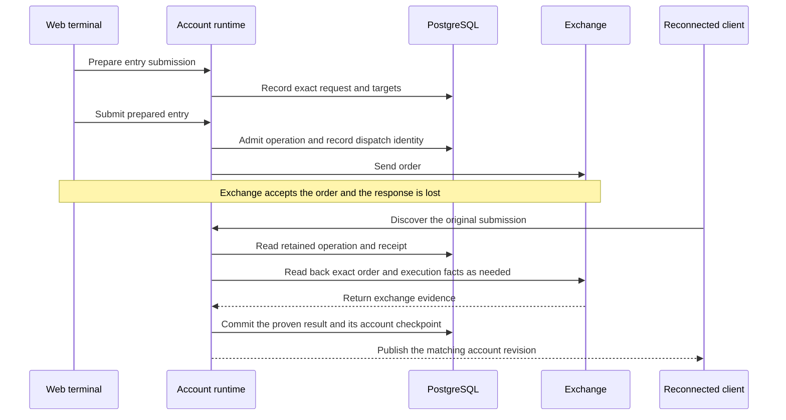

# Case study: recovering a trade after a lost response

[Overview](../README.md) · [Backend architecture](backend-architecture.md) · [Data correctness](data-correctness.md)

A trader submits an entry. The exchange accepts the order, but the response is lost. From the browser, that looks like a timeout. The trader might reload, reopen the terminal on a phone, or return after the server has restarted. In each case, the terminal needs to recover the result of the original submission without creating another order.

## Prepare the command before dispatch

For a new entry, the server prepares a submission in PostgreSQL with its exact request, account targets, operation identity, and expiry. Preparation alone has no exchange effects. The server claims that submission as part of durable admission, then dispatches the command. If preparation expires before admission, sealing the submission under the same lock prevents a delayed request from dispatching it later.

PostgreSQL also retains the ownership and recovery records for admitted commands. For example, if an equivalent protection edit is already unresolved, the server can point the client to the existing operation. The client holds transient presentation state and can discover outstanding server records through an authenticated request after it reconnects.

## Recover facts before showing completion

The runtime reconciles against the exact order, execution, and position lifecycle. On the successful path, the operation result and the READY account checkpoint settle together. The client waits for the matching current account revision before acknowledging presentation. If that acknowledgement fails, the confirmed result remains discoverable and the client can retry the acknowledgement independently of the trade.

A proven rejection can complete as a rejection. If exact evidence is still missing when the observation budget runs out, the operation retains its uncertain outcome. Later explicit actions use current account authority and conflict checks. This lets the runtime preserve unresolved historical evidence while making a separate decision about whether it can safely admit new work.

## Scope recovery to the original targets

Close All illustrates why the exact inventory matters. The command retains the position lifecycles and pending orders it originally targeted. If an original pending order fills, recovery can follow its execution into the resulting position. A later position on the same symbol belongs to a different lifecycle. An empty current position list still leaves the original orders and their outcomes to be accounted for.

These guarantees cost durable writes, bounded observation, and transaction and reconnect tests. Local admission, exact target scope, and replay control belong to the terminal. Execution and the facts used to settle it belong to the exchange.
